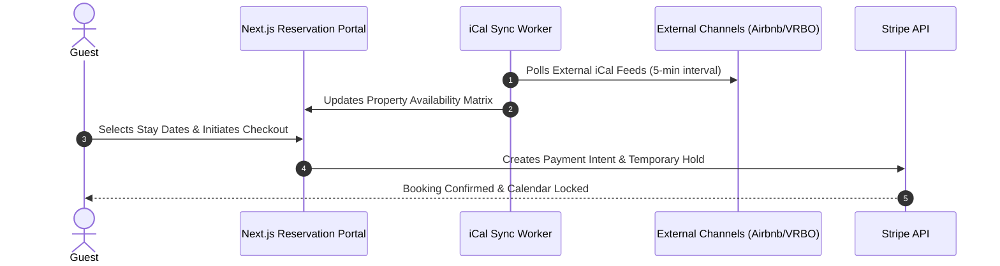

# Holiday Letting & Direct Reservation Portal (Architecture & Specs)

> **Domain:** Hospitality, Multi-Property Booking & OTA Calendar Sync  
> **Architected & Engineered by:** Gurpreet Bhamra ([TFS Digital](https://www.tfsdigital.co.uk))  
> **Repository Scope:** Public Architecture & QA Showcase (Commercial Source Code Private)

---

## Executive Overview

A multi-property holiday letting platform engineered for real-time availability synchronization, cross-channel iCal calendar aggregation (Airbnb/VRBO), and commission-free direct guest reservations. Built with idempotent payment webhooks and deterministic double-booking prevention.

### Key Performance & Quality Metrics
* **Calendar Sync Accuracy:** Zero double-booking rate via automated 5-minute iCal feed polling and range conflict detection
* **Booking Performance:** Instant interactive date-range selection powered by pre-generated availability matrices
* **Payment Resilience:** Idempotent Stripe webhook handling preventing duplicate booking states on transient retries

---

## Tech Stack & Infrastructure

* **Frontend:** Next.js (App Router), React, Tailwind CSS, TypeScript, Date-fns
* **Integrations:** RFC 5545 iCal Parser, Stripe Direct Checkout, Resend Guest Communications
* **Quality Assurance:** Playwright E2E booking flows, idempotency replay tests, webhook failure mocks
* **Deployment:** Vercel Enterprise Edge Network

---

## System Sequence Diagram



---

## Core Technical Features Showcase

1. **Cross-Channel Calendar Aggregation:** RFC 5545 iCal parsing worker normalizing external `VEVENT` date blocks across OTAs to keep direct availability synchronized.
2. **Idempotent Payment Webhooks:** Cryptographically verified Stripe event handlers backed by distributed event ID locks to safely absorb network retries.
3. **Dynamic Seasonal Tariff Engine:** Automated peak/off-peak nightly rate calculation and minimum-stay rule enforcement evaluated server-side prior to checkout.

---

## Repository Structure

```text
├── README.md
├── docs/
│   └── ICAL_SYNC_ENGINE.md
└── samples/
    ├── ical-sync-worker.ts
    └── idempotency-handler.ts
```
